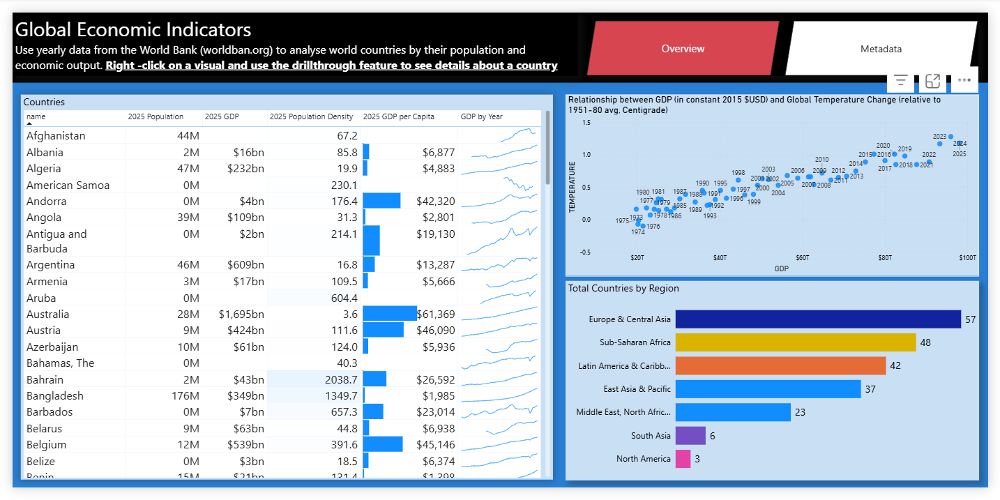
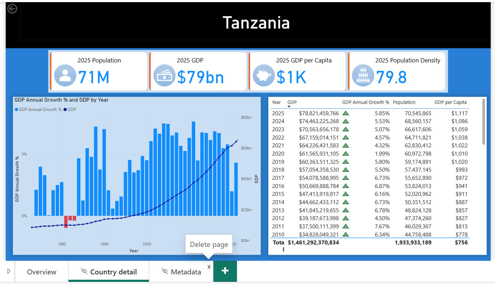
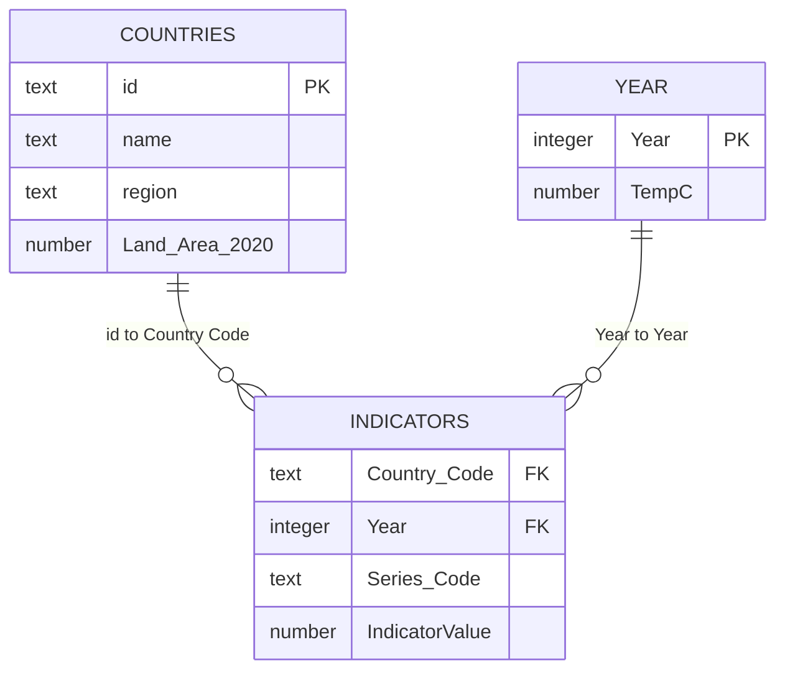

# Global Economic Indicators — Power BI

**Compare economic size, output per person and population across countries, then open a country's historical performance in one click.**

A Power BI portfolio project by **Jackson Josephat Kavishe**, developed while learning Power BI on **edX** and updated with economic and population observations through **2025**. It combines World Bank indicators with NASA annual temperature data in three report pages: **Overview**, **Country detail** and **Metadata**.

[Download the Power BI report](report/Global-Economic-Indicators.pbix) · [Data and definitions](docs/DATA.md) · [Build process](docs/METHODOLOGY.md) · [Open and refresh](docs/REFRESH.md)

## Why this project

A country's total GDP, GDP per capita, and population answer different questions. Comparing them together helps one distinguish a large economy from high output per person, see how population has changed, and investigate periods of stronger or weaker growth.

The report gives students, researchers and analysts a compact starting point for country comparisons and country-level exploration. Its purpose is to make those questions easy to investigate using a familiar table and a focused detail page.

## Overview

The country table puts population, real GDP, GDP per capita and population density side by side. Conditional formatting makes differences easier to see; GDP sparklines show the historical path within each row. The regional bar chart describes the report's geographic coverage, while the scatter plot displays annual GDP totals alongside global temperature anomalies.

| User question | Where to look |
| --- | --- |
| How large is an economy, and what is its output per person? | GDP and GDP-per-capita columns |
| How has its output evolved? | GDP sparkline, then Country detail |
| Which years experienced expansion or contraction? | Country-detail growth chart and annual table |
| How do population and economic output compare? | Population, GDP and GDP-per-capita measures together |
| What do the measures mean and where do they come from? | Metadata page and data documentation |

## Country drillthrough: Tanzania

Right-click **Tanzania** in the overview table, choose **Drill through → Country detail**, and use the back arrow to return. The selected country becomes the context for its cards, GDP/growth chart and annual data table.

The table provides precise values alongside the rounded headline cards. This navigation is Power BI **drillthrough**: it opens a separate page filtered to the selected country.

## Insights from the 2025 snapshot

| Finding | Evidence | What readers can investigate |
| --- | --- | --- |
| Tanzania's real GDP grew faster than its population between 2020 and 2025 | GDP increased **28.03%**, versus **15.70%** for population | How economic growth translates into output per person |
| Tanzania's output per person increased over the same period | Real GDP per capita rose from approximately **$1,010** to **$1,117**, an increase of **10.65%** | Whether per-capita performance follows the headline GDP trend |
| Tanzania's annual real-GDP growth strengthened in the latest year | **5.85%** in 2025, compared with **5.53%** in 2024 | The pace of growth across the annual series |
| Economic size and output per person give different comparisons | Algeria: **$231.62bn** GDP and **$4,883** per capita; Andorra: **$3.51bn** GDP and **$42,320** per capita | Why GDP and GDP per capita should be read together |

All dollar figures above use **constant 2015 US dollars**. Tanzania's 2025 population is **70,545,865**. These findings are calculated from the included source snapshot; they can be checked against the annual rows in Power BI and the CSV data.

## How it was built

1. **Prepare the sources.** Load country-level World Bank GDP, population and land-area observations, country metadata, indicator definitions, and NASA annual temperature anomalies.
2. **Transform the data.** Set data types, select the indicator fields, filter economic series, prepare the 2020 land-area lookup, and join temperature data to a distinct year table.
3. **Build the model.** Relate the indicator fact table to country and year dimensions using active, single-direction, many-to-one relationships.
4. **Write the measures.** Calculate population, real GDP, GDP per capita, population density, annual GDP growth and the fixed 2025 headline values.
5. **Design the report.** Combine the comparison table, conditional formatting, sparklines, historical chart, drillthrough page and metadata navigation.
6. **Check the publication.** Reconcile the model against the source CSVs, independently calculate the sample insights, and check the source exports and documentation links.

The actual [DAX measures](src/dax/measures.dax) and [Power Query definitions](src/power-query/query-index.json) are included for inspection. The [methodology](docs/METHODOLOGY.md) explains the model and calculations.

## Model

The published report has **21,457 GDP/population observations**, **53 years (1973–2025)** and **11 measures**. Indicator metadata is stored separately; the measures table groups calculations.

## Data scope and interpretation

- The source snapshot covers **217 economies**; the current report's land-area join retains **216** country-dimension members. Kosovo (`XKX`) is present in the source facts but does not have a matching dimension row. The [validation notes](docs/VALIDATION.md) record this explicitly.
- Source GDP is available for **186 economies in 2025**; **185** map to the report's country table. The regional chart counts represented economies, not complete GDP coverage.
- The published density formula uses **2025 population divided by 2020 land area**. Its land vintage is fixed in this version. The source file also contains newer land observations through 2024.
- Population cards may round small economies to `0M`; consult the source data for their actual populations. The country-detail table's totals accumulate years, so use its annual rows when interpreting GDP and population.

See [data definitions](docs/DATA.md) for indicator codes, units and source attribution.

## Use the project

Download this repository, open `report/Global-Economic-Indicators.pbix` in Power BI Desktop, and explore the embedded snapshot. Before refreshing, point the two local CSV queries to this repository's `data` folder using the [refresh instructions](docs/REFRESH.md).

GitHub displays the documentation and screenshots and provides the downloadable PBIX. Interaction happens in Power BI Desktop; this repository does not include a hosted Power BI Service report.

| Folder | Purpose |
| --- | --- |
| `report/` | One canonical PBIX |
| `images/` | Overview and Tanzania drillthrough screenshots supplied by the author |
| `data/` | Original supplied input CSVs and publication provenance |
| `src/` | DAX and M definitions extracted from this PBIX |
| `docs/` | Methodology, data definitions, refresh guide and validation |
| `scripts/` | Reproducible snapshot validation and insight calculations |

The uploaded working ZIP, duplicate screenshots, superseded DAX and old update plans are not duplicated here. GitHub's **Code → Download ZIP** provides an archive of the published repository.

## Author and learning context

**Jackson Josephat Kavishe** · Economics and data analysis · [GitHub profile](https://github.com/jacksonkavishe)

Developed as an **edX Power BI learning project**, then updated with 2025 economic and population data. The economic and temperature data remain credited to their original providers. See [attribution](ATTRIBUTION.md).
